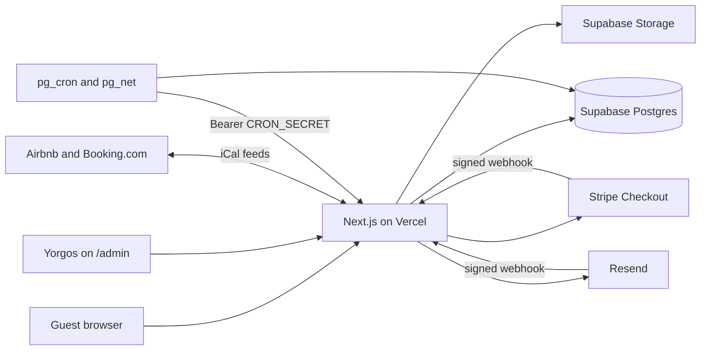

# Casa Filakopi

Direct-booking site for Casa Filakopi, one whole-house rental on Milos, at miloscasa.com. The previous static site is in `legacy/` until cutover.

- Plan and status: [docs/PLAN.md](docs/PLAN.md)
- Requirements: [docs/requirements.md](docs/requirements.md)
- Operations: [docs/runbook.md](docs/runbook.md)
- Database: [docs/data-model.md](docs/data-model.md)
- For Yorgos: [docs/host-guide.md](docs/host-guide.md)

## Architecture

Next.js 16 App Router in TypeScript, on Vercel, with Supabase (Postgres, Auth, Storage) in the EU, Stripe hosted Checkout, Resend for email, and next-intl for English and Greek.



The rules that hold everything together:

- **Overbooking cannot happen.** Every occupied date owns a row in `inventory_claims`, whose exclusion constraint refuses overlaps even under concurrent requests.
- **Prices are computed on the server**, and a booking confirms only from a verified Stripe webhook.
- **Money and inventory change only through database functions**, called with the secret key after an admin role check. Row Level Security is on for every table.
- **Yorgos edits rules, prices, text and photos in Admin.** They live in the database, not in code.

| Folder                    | What it holds                                              |
| ------------------------- | ---------------------------------------------------------- |
| `app/[locale]`            | Public site, `/en` and `/el`                               |
| `app/admin`               | Admin panel, its own root layout, not locale-prefixed      |
| `app/api`                 | Route handlers: contact, consent, webhooks, cron, iCal     |
| `lib/domain`              | Business logic with no framework imports                   |
| `lib/admin`               | Admin data, actions, strings                               |
| `lib/cms`                 | Content registry, public reads, editing                    |
| `lib/channels`            | Airbnb and Booking.com iCal sync                           |
| `lib/email`               | Queue, worker, templates data, webhooks                    |
| `lib/invoicing`           | Documents, PDF, Excel, ZIP                                 |
| `lib/log.ts`              | Structured logs and optional Sentry, with no personal data |
| `lib/security-headers.ts` | Public security headers and the indexing rule              |
| `lib/seo.ts`              | Canonicals, hreflang, JSON-LD                              |
| `emails`                  | Email templates                                            |
| `messages`, `i18n`        | Public strings and locale config                           |
| `supabase/migrations`     | Schema, RPCs, RLS, scheduled jobs                          |
| `tests`                   | `unit`, `db` and `e2e`                                     |

## Local setup

You need Node 24, pnpm, Docker and the Supabase CLI.

```bash
export PATH=/opt/homebrew/opt/node@24/bin:$PATH   # Node 24 is not the machine default
pnpm install
supabase start                                    # local database, mail at :54324
cp .env.example .env.local                        # fill in from `supabase status`
pnpm migrate:content
pnpm migrate:media
pnpm dev                                          # http://localhost:3000
```

The first Owner is created by hand: see "First Owner" in the [runbook](docs/runbook.md). Sign-ups are closed.

| Command                              | What it does                                                   |
| ------------------------------------ | -------------------------------------------------------------- |
| `pnpm lint`                          | ESLint                                                         |
| `pnpm typecheck`                     | TypeScript                                                     |
| `pnpm format:check`                  | Prettier                                                       |
| `pnpm test`                          | Unit tests                                                     |
| `pnpm test:db`                       | Database tests, on local Supabase                              |
| `pnpm test:e2e`                      | Playwright on the dev server                                   |
| `pnpm test:static`                   | Caching and outage checks on a production build                |
| `pnpm test:prod`                     | CSP, SEO and accessibility on a staging-style production build |
| `PROD_INDEXABLE=true pnpm test:prod` | The same on a production-style build                           |
| `pnpm lighthouse`                    | Lighthouse budget, with `next start -p 3011` running           |
| `pnpm build`                         | Production build                                               |

## Environment variables

Secrets never go in the repo, the browser or chat. `.env.example` lists them with notes.

| Variable                               | Where            | Purpose                                                                                |
| -------------------------------------- | ---------------- | -------------------------------------------------------------------------------------- |
| `NEXT_PUBLIC_SITE_URL`                 | All              | Site address. Decides canonicals, and whether the site is indexed                      |
| `NEXT_PUBLIC_INDEXABLE`                | Optional         | `true` allows indexing on another host. Leave empty on staging                         |
| `NEXT_PUBLIC_SUPABASE_URL`             | All              | Supabase project                                                                       |
| `NEXT_PUBLIC_SUPABASE_PUBLISHABLE_KEY` | All              | Public key, bound by RLS                                                               |
| `SUPABASE_SECRET_KEY`                  | Server only      | Bypasses RLS. Also keys the sign-in throttles                                          |
| `CRON_SECRET`                          | Server, Vault    | Protects `/api/cron/*`. 32 or more characters                                          |
| `GUEST_TOKEN_SECRET`                   | Server only      | Computes guests' private links. Changing it breaks links already sent                  |
| `RESEND_API_KEY`                       | Server only      | Sending. Empty locally: mail goes to Mailpit                                           |
| `RESEND_WEBHOOK_SECRET`                | Server only      | Delivery events                                                                        |
| `NEXT_PUBLIC_TURNSTILE_SITE_KEY`       | All              | Contact form. Required in production, or the form closes and shows the phone and email |
| `TURNSTILE_SECRET_KEY`                 | Server only      | As above                                                                               |
| `STRIPE_SECRET_KEY`                    | Server only      | Track PAY                                                                              |
| `STRIPE_WEBHOOK_SECRET`                | Server only      | Track PAY                                                                              |
| `NEXT_PUBLIC_STRIPE_PUBLISHABLE_KEY`   | All              | Track PAY                                                                              |
| `SENTRY_DSN`                           | Optional, server | EU project only (`*.ingest.de.sentry.io`), or tracking stays off                       |

Jobs that call the site also need two Vault secrets per environment, `site_url` and `cron_secret`. Until both exist those jobs do nothing, and Home says so. See the [runbook](docs/runbook.md).

## Migrations

Schema changes only through files in `supabase/migrations`, never the dashboard.

```bash
supabase migration new <name>      # write the SQL
supabase migration up              # apply locally
pnpm db:types                      # regenerate lib/db/types.ts, and commit it
```

CI fails if `lib/db/types.ts` does not match the schema. `supabase db reset` rebuilds a local database from nothing. On staging or production use `supabase db push`, after checking which project is linked.

New public tables get Row Level Security through the same pattern as `20261107000006_rls_storage.sql`. Every new function starts with `revoke all ... from public, anon, authenticated`, because Supabase grants execute by default. `tests/db/rls.test.ts` fails otherwise.

## Loading content and photos

Public pages read text and photos from Supabase, so **run both imports before the first deploy to any environment**, content first, then photos. A build with an empty database still succeeds, but the site then points at photos that are not in the bucket yet.

Local: `pnpm migrate:content`, then `pnpm migrate:media`.

Staging, from a checkout, with the secret key in your shell and never in a file:

```bash
export NEXT_PUBLIC_SUPABASE_URL=https://<staging-ref>.supabase.co
export SUPABASE_SECRET_KEY=<secret key>
pnpm migrate:content --staging=<staging-ref>
pnpm migrate:media --staging=<staging-ref>
unset SUPABASE_SECRET_KEY
```

Production (T7.2) is the same with `--production=<production-ref>`. The flag must name the project in `NEXT_PUBLIC_SUPABASE_URL`, and both values must come from the shell.

Both imports are safe to repeat: they add what is missing and never change what Yorgos has edited.

## Deployment

Vercel builds every push; `master` is production and `dev-booking` is staging.

1. Set the environment variables above in Vercel, per environment.
2. `supabase db push` to the matching project.
3. Run the imports, once, for a new environment.
4. Set the Vault secrets, and `CRON_SECRET` in Vercel to the same value.
5. Add `https://<host>/admin/auth/confirm` to the Auth redirect URLs of that Supabase project, or invitation and reset links will not work.
6. Point the Stripe and Resend webhooks at that host.
7. Set `NEXT_PUBLIC_SITE_URL`. Only `miloscasa.com` and `www.miloscasa.com` are indexed, so staging is noindex by itself.

The app is `output: "standalone"`, so a `Dockerfile` keeps it portable to any Docker host.
