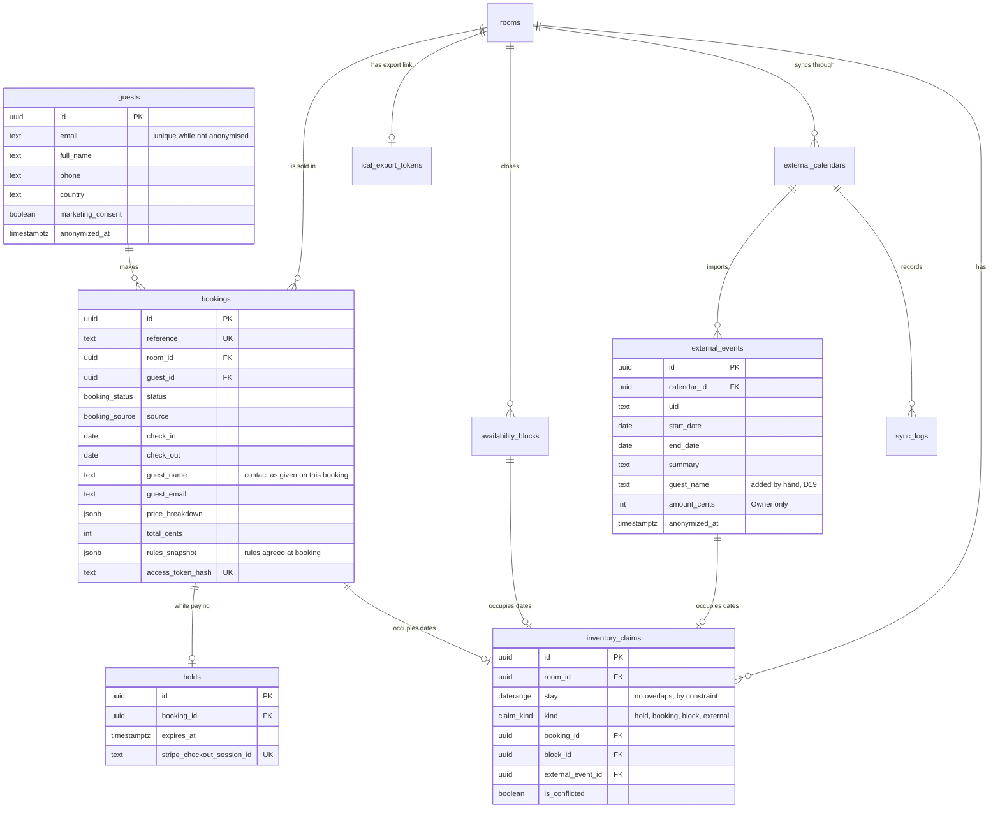
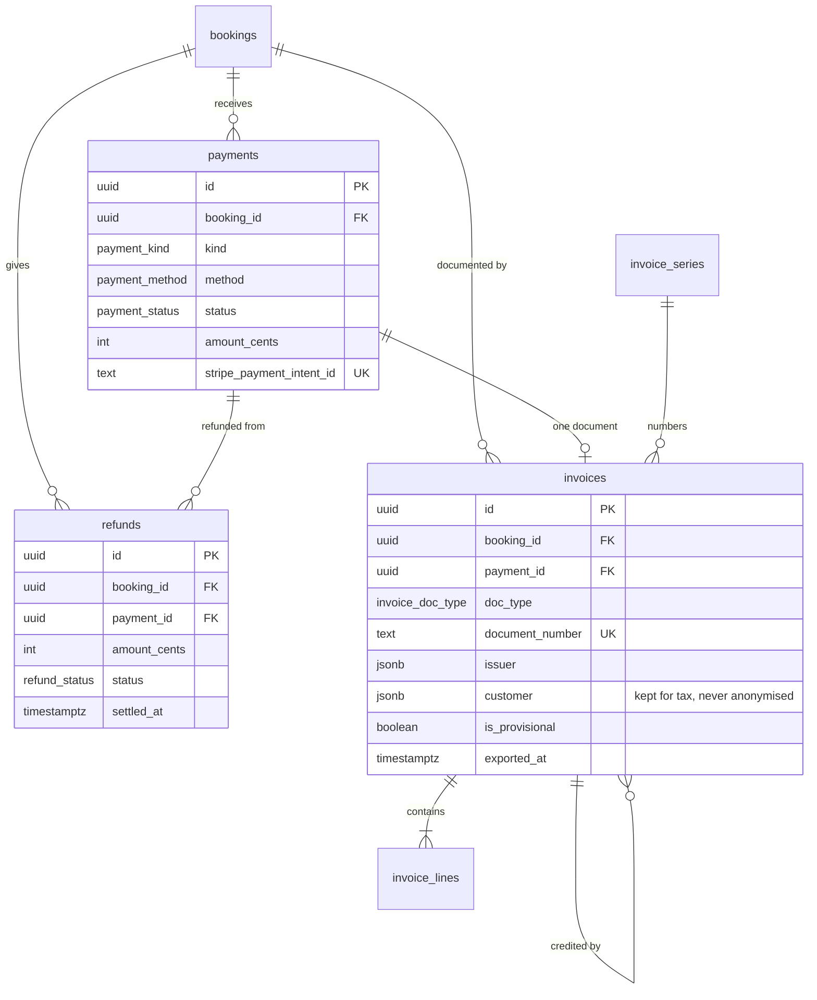
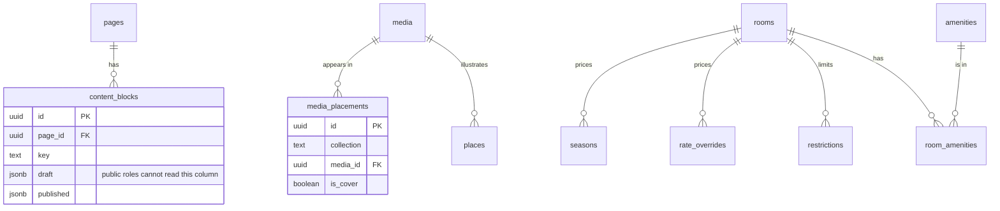
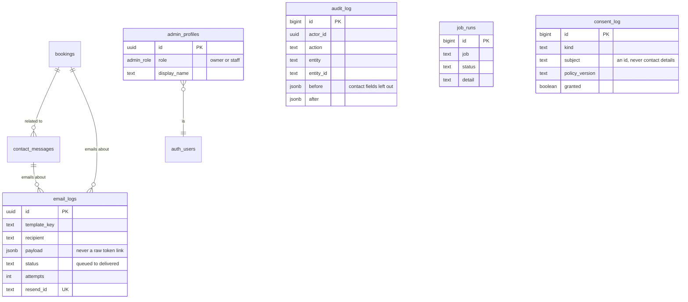

# Data model

The schema lives in `supabase/migrations`; `lib/db/types.ts` is generated from it. This page explains how it fits together. D15 in `docs/PLAN.md` lists where it differs from the original spec.

Conventions: timestamps are UTC, stay dates are `date` with an exclusive check-out, business logic runs in Europe/Athens. Money is integer cents in EUR. Translatable text is `jsonb` keyed by locale, `{"en": "...", "el": "..."}`.

## Bookings and inventory

**`inventory_claims` is the only table that holds the overbooking rule.** Its exclusion constraint makes an overlap impossible, even under concurrent requests. An imported event that collides is stored with `is_conflicted = true`, outside the constraint, so it is flagged and never lost.

`bookings.guest_*` is what was typed on that booking. A guest entering an existing email never changes the stored guest (unauthenticated callers cannot edit a guest).

## Money and documents

Issued invoices and their lines are immutable: triggers refuse any change except `pdf_path`, `mydata` and `exported_at`. Numbers come from `next_invoice_number`, under a row lock.

`stripe_events` is keyed by Stripe's event id, so each event is handled once.

## Content and rates

`property` is a single row of legal details and the internal notification address. The public address and phone come from the CMS (D28). `settings` holds rules Yorgos edits, as `jsonb` by key: `payment`, `invoicing`, `retention` and others. `faq`, `testimonials` and `places` are published lists.

## Messages, email and operations

## Who can read what

Row Level Security is forced on every table, and access starts at nothing.

| Who | Reads | Writes |
| --- | --- | --- |
| Anonymous | Published content, `property`, public settings, `public_availability()` | Nothing directly |
| Staff | Operational data: bookings, guests, messages, calendars | Stay rules, message status |
| Owner, with two-step | Everything, including money, audit log, jobs | Configuration and content |
| Secret key, server only | Everything, skipping RLS and MFA | Through RPCs, after `current_admin_role()` |

`current_admin_role()` returns null for an Owner without an aal2 session, so MFA cannot be skipped by a client.

## Database functions

All are called by the server with the secret key.

| Area | Functions |
| --- | --- |
| Booking | `create_hold`, `attach_checkout_session`, `confirm_booking`, `confirm_without_payment`, `create_manual_booking`, `modify_booking`, `cancel_booking`, `transition_booking` |
| Money | `record_payment`, `reserve_refund`, `settle_refund`, `record_refund` |
| Calendar | `create_block`, `remove_block`, `upsert_external_event`, `remove_missing_external_events`, `update_external_event_details` |
| Documents | `issue_invoice`, `issue_credit_note`, `attach_invoice_pdf`, `mark_invoices_exported` |
| Settings | `save_rules`, `update_booking_notes` |
| Jobs | `run_database_job`, `release_expired_holds`, `complete_finished_bookings`, `purge_admin_attempts`, `apply_retention`, `call_cron_route` |
| Privacy | `anonymise_guest`, `anonymise_external_guest`, internal `scrub_personal_data`, `has_open_money` |
| Users | `add_admin`, `change_admin_role`, `remove_admin`, `delete_auth_sessions` |
| Guests | `booking_for_token`, `public_availability` |

Errors are raised by message, such as `dates_unavailable` or `guest_has_stay`, and the app turns them into plain words.

## Server actions and routes

Server actions are in `lib/admin/actions`, `lib/cms/actions`, `lib/channels/actions.ts`, `lib/email/admin-actions.ts` and `lib/invoicing/actions.ts`. Each starts with `requireAdmin()` or `requireOwner()`, validates with Zod, and calls an RPC through `callAdminRpc`, which checks the role in the database and passes the admin as `p_actor`.

| Route | Who | Purpose |
| --- | --- | --- |
| `POST /api/contact` | Public: origin check, Turnstile, Zod, rate limit | Contact form |
| `POST /api/consent` | Public: origin check, Zod, rate limit | Cookie choice log |
| `GET /api/ical/[file]` | Secret in the file name | Calendar for the channels |
| `POST /api/email/webhook` | Signed by Resend | Delivery events |
| `/api/cron/*` | Bearer `CRON_SECRET` | Jobs: `email`, `email/scheduled`, `channel-sync`, `cms`, `health` |
| `GET /api/health` | Public | Uptime check |
| `GET /admin/guests/[id]/export` | Owner | A guest's data as Excel |
| `GET /admin/bookings/export` | Owner | Bookings as Excel |
